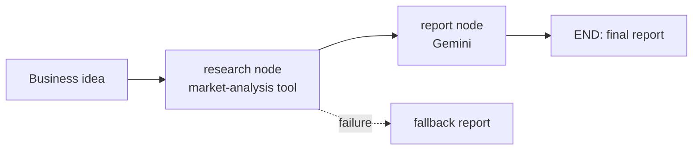

# LangGraph Market-Research Agent

A small **stateful LLM agent** built with **LangGraph**: given a business idea, it calls a market-analysis tool, keeps the results in a typed shared state, and asks **Gemini** to write an executive-summary report. It degrades gracefully to a structured, non-LLM report when no API key is available.

Built during a hands-on workshop on agent frameworks (LangGraph, MCP-style tools, agent-to-agent protocols).

## Workflow



- **Typed state** (`TypedDict`): idea, analysis, completion flag, final report and an append-only message log (`Annotated[list, operator.add]`).
- **Tool node**: `tools/market_analyst.py` exposes the analysis as a standalone, MCP-style tool (market size, competition, growth, demographics, risks, opportunities). The data it returns is simulated.
- **LLM node**: builds an analyst prompt from the state and generates the report with Gemini.
- **Error handling**: failures in either node are caught and recorded in state; the report node falls back to a deterministic template.

## Run it

```bash
cd market_research_agent
pip install -r requirements.txt
export GEMINI_API_KEY="your-key"   # optional
python main.py          # interactive
python main.py --demo   # demo run
```

## Stack

Python · LangGraph · Google Gemini API
